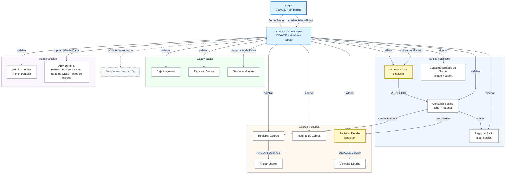

# Ventanas del sistema — AltosRoca

Mapa de navegación y ficha funcional de cada ventana Tkinter de la aplicación.
Sirve para entender **qué hace cada pantalla, cómo se llega a ella y qué datos
lee o escribe** en la base SQLite.

- **Punto de entrada:** `app/login.py`.
- **Shell:** `app/principal.py` (dashboard con topbar y sidebar).
- **Módulos:** cada archivo de `app/` es una ventana (`tk.Toplevel`) o un helper.
- **Base:** `data/altosroca.db` (en modo exe, junto al ejecutable).

---

## 1. Diagrama de ventanas

**Leyenda**

- Flecha sólida: la ventana se abre desde un botón, menú o acción explícita.
- Flecha punteada: apertura automática, navegación de retorno o caso no
  mapeado.
- Azul: ventana raíz (`tk.Tk`). Amarillo: ventana *singleton* (se reutiliza,
  no se destruye al cerrar).
- Gris punteado: módulo no mapeado o en construcción.

> `Anular Cobros`, `Cancelar Deudas` y `Gestionar Gastos` no están en el sidebar:
> se llega a ellas desde otra ventana o desde el menú **Alta de Datos**.

---

## 2. Resumen de ventanas y datos

| Ventana | Archivo | Se abre desde | Lee | Escribe |
|---------|---------|---------------|-----|---------|
| Login | `app/login.py` | Inicio / Cerrar Sesión | `Login` | — |
| Principal | `app/principal.py` | Login | — | — |
| Acceso Socios | `app/acceso_socios.py` | Sidebar / auto | `tbSocios`, `tbPlan`, `tbPagos`, `tbSociosAcceso` | — |
| Registrar Socio | `app/registrar_socio.py` | Sidebar / Consultar Socios | `tbSocios`, `tbPlan` | `tbSocios` |
| Consultar Socios | `app/consultar_socios.py` | Sidebar / Acceso Socios | `tbSocios`, `tbPlan`, `tbPagos`, `tb_RegistroDeudas`, `tbSociosAcceso` | `tbSociosAcceso` |
| Consultar Estados | `app/consultar_estados_socios.py` | Sidebar | `tbSocios`, `tbPagos`, `tbPlan`, `tb_RegistroDeudas` | — |
| Registrar Cobros | `app/registrar_cobros.py` | Sidebar / Consultar Socios | `tbSocios`, `tbPlan`, `tbPagos`, `tb_RegistroDeudas` | `tbPagos` |
| Anular Cobros | `app/anular_cobros.py` | Registrar Cobros | `tbSocios`, `tbPagos` | `tbPagos` (DELETE) |
| Historial de Cobros | `app/historial_cobros.py` | Sidebar | `tbPagos`, `tb_RegistroDeudas`, `tbIngresosGenerales`, `tbSocios`, `tb_TipoPago` | — |
| Registrar Deudas | `app/registrar_deudas.py` | Sidebar / Consultar Socios | `tbSocios`, `tb_RegistroDeudas` | `tb_RegistroDeudas` |
| Cancelar Deudas | `app/cancelar_deudas.py` | Registrar Deudas | `tbSocios`, `tb_RegistroDeudas` | `tb_RegistroDeudas` (UPDATE) |
| Caja | `app/caja.py` | Sidebar | `tbPagos`, `tb_RegistroDeudas`, `tbIngresosGenerales`, `tbGastosGenerales`, `tbSocios`, `tb_TipoPago` | — |
| Registrar Gastos | `app/registrar_gastos.py` | Sidebar / topbar | `tbTiposGastos`, `tb_TipoPago`, `tbGastosGenerales` | `tbGastosGenerales` |
| Gestionar Gastos | `app/gestionar_gastos.py` | Topbar | `tbGastosGenerales`, `tbTiposGastos`, `tb_TipoPago` | `tbGastosGenerales` (UPDATE/DELETE) |
| Admin Cuentas | `app/admin_cuentas.py` | Sidebar / topbar | `Login`, `NivelAcceso` | `Login` |
| ABM genérico | `app/abm_generico.py` | Topbar | `tbPlan`, `tb_TipoPago`, `tbTiposGastos`, `tbTiposIngresos` | las mismas tablas |

---

## 3. Autenticación y shell

### 3.1 Login

- **Archivo:** `app/login.py`
- **Tipo:** `tk.Tk` raíz, 730×330, `overrideredirect(True)` (sin bordes del SO).
- **Apertura:** al iniciar el programa y al cerrar sesión desde Principal.
- **Cierre:** botón propio de cerrar o `WM_DELETE_WINDOW`; termina el proceso.

**Comportamiento**

1. Muestra el logo y dos campos: usuario y contraseña.
2. Se puede arrastrar desde la barra superior; tiene botones propios de
   minimizar y cerrar.
3. `ACCEDER` o la tecla **Enter** disparan la validación.
4. Si las credenciales son válidas, destruye el login y llama a
   `principal.main(usuario)`.
5. Si son inválidas, muestra un error y deja la ventana abierta.

**Datos**

- **Lee:** `Login` (`UserName`, `Password`) con
  `SELECT 1 FROM Login WHERE UserName = ? AND Password = ?`.
- **Escribe:** nada.

**Validaciones**

- Usuario y contraseña obligatorios (se aplica `strip`).
- No hay bloqueo por intentos, expiración de sesión ni fortaleza de contraseña.
- La contraseña se compara en texto plano (deuda técnica documentada en
  `db.py`).

**Notas**

- El login puede abrirse de nuevo después de un logout, por lo que conviven
  ciclos de `mainloop` anidados.
- Si falta la base, muestra `FileNotFoundError` con la ruta esperada.

---

### 3.2 Principal (Dashboard)

- **Archivo:** `app/principal.py`
- **Tipo:** `tk.Tk` raíz, 1366×768, no redimensionable.
- **Apertura:** únicamente desde un login exitoso.
- **Cierre:** `WM_DELETE_WINDOW`; si no hubo logout, `sys.exit(0)`.

**Comportamiento**

- **Topbar:**
  - `Admin` → `Admin Pantalla (cuentas de usuario)`.
  - `Alta de Datos` → Registrar Gastos, Gestionar Gastos, ABM Planes,
    ABM Formas de Pago, ABM Tipos de Gasto, ABM Tipos de Ingreso.
  - `Gráficos Estadísticos` y `Ayuda` están deshabilitados (“próximamente”).
  - `Cerrar Sesión {usuario}` → vuelve al login.
- **Sidebar (10 módulos):** Acceso Socios, Registrar Socios, Consultar Estados
  Socios, Consultar Socios, Registrar Cobros, Consultar Caja, Historial de
  Cobros, Registrar Deudas, Registrar Gastos, Admin Pantalla.
- Al entrar, abre automáticamente **Acceso Socios**.
- Cada módulo se abre como `Toplevel` no modal; si el nombre no está mapeado,
  muestra una ventana `[Módulo en construcción]`.

**Datos**

- No ejecuta SQL. Solo pasa el usuario logueado a los módulos que lo necesitan
  (`Registrar Cobros`, `Consultar Socios`, `Registrar Deudas`, etc.).

**Notas**

- El usuario se guarda en la global `_current_user` (valor inicial `"Admin"`).
- `Anular Cobros` tiene rama de apertura pero **no** figura en el sidebar; solo
  se llega desde Registrar Cobros.
- `__main__` arranca con el usuario hardcodeado `"MARCO"` si se ejecuta el
  módulo directamente.

---

## 4. Socios y accesos

### 4.1 Acceso Socios

- **Archivo:** `app/acceso_socios.py`
- **Tipo:** `tk.Toplevel` singleton; al cerrar hace `withdraw()` y se reutiliza.
- **Apertura:** automática desde Principal y por sidebar.
- **Cierre:** oculta la ventana y devuelve el foco al dashboard.

**Comportamiento**

1. Campo grande para el **DNI**; solo acepta dígitos.
2. **Enter** busca al socio; un segundo **Enter** limpia el campo.
3. Muestra nombre, plan, vencimiento, estado (HABILITADO / INHABILITADO), foto e
   ingreso previo del día.
4. `VER SOCIO` abre **Consultar Socios** con el socio precargado.

**Datos**

- **Lee:**
  - `tbSocios` (`idSocio`, `Apellidos`, `Nombres`, `Documento`, `Estado`,
    `id_Plan`, `pathImage`) por `Documento`, con fallback por `idSocio`.
  - `tbPlan` (`Nomenclatura`).
  - `tbPagos` (`MAX(FechaVencimineto)`) para decidir habilitación.
  - `tbSociosAcceso` (último `FechaAcceso` del día).
- **Escribe:** nada.

**Validaciones**

- DNI no vacío y numérico.
- La habilitación depende de que exista un pago con vencimiento ≥ hoy
  (`simclock.hoy()`).

**Notas**

- A pesar del nombre, **esta ventana no registra el acceso**. El alta manual en
  `tbSociosAcceso` se hace desde Consultar Socios (“Registrar Ingreso”).
- Ignora `tbSocios.Estado` para el cartel de habilitado.
- `_parse_date` puede lanzar `ValueError` si el dato viene con formato raro.
- El singleton puede sobrevivir al cierre de su ventana padre.

---

### 4.2 Registrar Socio

- **Archivo:** `app/registrar_socio.py`
- **Tipo:** `tk.Toplevel` no modal (desde Consultar Socios se espera con
  `wait_window`).
- **Apertura:** sidebar (`Registrar Socios`) o botón **Editar** de Consultar
  Socios (con `socio_id`).
- **Cierre:** `Guardar` exitoso, `Cancelar` o Escape.

**Comportamiento**

1. Formulario en cuatro grupos: datos personales, contacto, información médica
   y datos de socio.
2. En alta, calcula el próximo `NroInscripcion` numérico y el próximo
   `idSocio`.
3. Permite cargar foto desde archivo o cámara, o quitarla.
4. Calcula el IMC en vivo con `Altura` y `Peso`.
5. `Guardar` inserta o actualiza y cierra; el llamador recarga su grilla.

**Datos**

- **Lee:**
  - `tbPlan` (`idPlan`, `Nomenclatura`, `Descripcion`), excluyendo la fila
    placeholder `------`.
  - `tbSocios`: `MAX(idSocio)`, `MAX(NroInscripcion)` numérico y la fila
    completa en modo edición.
- **Escribe:**
  - **Alta:** `INSERT INTO tbSocios` con `idSocio`, `NroInscripcion`,
    `Apellidos`, `Nombres`, `Documento`, `Sexo`, `FecNac`, `Edad`, `Domicilio`,
    `Localidad`, `ObraSocial`, `Provincia`, `TelefonoUrgencia`, `Telefono`,
    `Email`, `InformacionMedica`, `AlergicoA`, `Medicacion`, `Altura`, `Peso`,
    `Estado`, `FechaAlta`, `id_Plan`, `Ocupacion`, `Password`, `pathImage`.
  - **Edición:** `UPDATE` de las columnas editables por `idSocio`.
  - `Estado = '1'`, `Password` vacío y `FechaAlta` actual al crear.

**Validaciones**

- `Documento`, `Apellidos` y `Nombres` obligatorios.
- Fechas en `dd/mm/yyyy` (DateEntry o texto); fecha inválida muestra aviso.
- `Sexo` es de solo lectura; el plan es opcional.
- La foto exige un `Documento` numérico.

**Notas**

- `MAX+1` para IDs y `NroInscripcion` no es atómico: dos altas simultáneas
  podrían colisionar. No hay validación de documento duplicado.
- En edición no se modifican `NroInscripcion`, `Estado`, `FechaAlta`,
  `FechaBaja` ni `Password`.
- `Provincia` se envía siempre vacía.
- Quitar la foto limpia la UI y `pathImage`, pero no borra el archivo del disco.
- Cámara: OpenCV/DSHOW como backend principal y pygame como respaldo; usa
  archivos temporales y reabre la cámara tras 12 frames fallidos.

---

### 4.3 Consultar Socios

- **Archivo:** `app/consultar_socios.py`
- **Tipo:** `tk.Toplevel` no modal.
- **Apertura:** sidebar, o desde Acceso Socios con `socio_id`.
- **Cierre:** `Salir` o Escape.

**Comportamiento**

1. Búsqueda por documento, apellidos, nombres o nombre completo.
2. Si hay varias coincidencias, muestra un selector.
3. Paneles: **SOCIO** (foto y datos), **INFORMACION** (plan, vencimiento,
   saldo) e **INGRESOS** (últimos 50 accesos).
4. Acciones:
   - `Cobro de cuota` → Registrar Cobros (con `socio_id`).
   - `Editar` → Registrar Socio (con `socio_id`).
   - `Ver Deudas` → Registrar Deudas (con `socio_id`).
   - `Registrar Ingreso` → alta manual en `tbSociosAcceso`, con confirmación.
5. Al volver de una ventana hija, recarga la ficha.

**Datos**

- **Lee:**
  - `tbSocios` (`SELECT *` por `idSocio`).
  - `tbPlan` (`Nomenclatura`, `Descripcion`).
  - `tbPagos`: último pago, `MAX(FechaVencimineto)`, `SUM(Importe)` y último
    `Saldo`, excluyendo `Eliminado = '1'`.
  - `tb_RegistroDeudas`: `SUM(ImporteDeuda)` de deudas activas.
  - `tbSociosAcceso`: últimos 50 ingresos.
- **Escribe:** `INSERT INTO tbSociosAcceso` (`idIngreso` = `MAX+1`, `idSocio`,
  `idPlan`, `FechaAcceso`, `Estado`, `EstadoSaldo`, `EstadoAcceso = 0`) al usar
  “Registrar Ingreso”.

**Validaciones**

- La búsqueda no puede estar vacía.
- El ingreso manual pide confirmación (`askyesno`).

**Notas**

- El ingreso manual no registra operador y puede duplicar el ingreso del día.
- `_register_pago` existe pero no se usa (código muerto).
- El `finally` puede referenciar `conn` sin asignar si falla la conexión.
- El IMC asume `Altura` en metros.

---

### 4.4 Consultar Estados de Socios

- **Archivo:** `app/consultar_estados_socios.py`
- **Tipo:** `tk.Toplevel` no modal.
- **Apertura:** sidebar (`Consultar Estados Socios`).
- **Cierre:** `Salir` o Escape.

**Comportamiento**

1. Filtros: `ACTIVOS`, `INACTIVOS`, `ACTIVOS C/SALDO`, `POR DÍA`,
   `ACTIVOS POR PLAN`, `INACTIVOS POR PLAN`.
2. Selector de plan y fecha; búsqueda libre sobre la grilla.
3. Treeview de 10 columnas con estado coloreado y contador de resultados.
4. `Exportar a Excel` y `Exportar a PDF` generan el archivo desde la grilla
   visible.

**Datos**

- **Lee:**
  - `tbSocios` (`idSocio`, `Apellidos`, `Nombres`, `Documento`,
    `NroInscripcion`, `Estado`, `id_Plan`, `FechaBaja`), excluyendo documentos
    placeholder y exigiendo al menos un dígito.
  - `tbPagos` (último pago por socio: `FechaVencimineto`, `FechadePago`,
    `Importe`, `Saldo`, `Eliminado`).
  - `tbPlan` (`idPlan`, `Descripcion`).
  - `tb_RegistroDeudas` (`idSocio` con deuda activa, distintos).
- **Escribe:** nada.

**Validaciones**

- No hay validación explícita de filtros; la fecha se parsea.
- El plan por defecto es `MUSC APAR` (hardcodeado).

**Notas**

- Solo considera el **último pago** de cada socio: un socio sin pagos no
  aparece.
- `POR DÍA` también compara contra el último pago, no contra todos.
- La búsqueda sobre la grilla elimina filas hasta el próximo refresco y es
  case-sensitive para nombres.
- “Hoy” sale de `simclock.hoy()`.
- El PDF del exporter está dimensionado para 10 columnas; si cambia la grilla,
  hay que ajustarlo.

---

## 5. Cobros y deudas

### 5.1 Registrar Cobros

- **Archivo:** `app/registrar_cobros.py`
- **Tipo:** `tk.Toplevel` no modal.
- **Apertura:** sidebar o desde Consultar Socios con `socio_id`.
- **Cierre:** `Salir`, `X` o Escape.

**Comportamiento**

1. Búsqueda por documento o nombre; si hay varias coincidencias, selector
   modal.
2. Panel izquierdo: historial de pagos del socio.
3. Panel derecho: fecha, descuento y motivo, interés, entrega (solo lectura),
   forma de pago y observaciones.
4. `Cambiar Vencimiento` abre un modal para fijar el próximo vencimiento.
5. `COBRAR` confirma y registra el pago; `ANULAR COBROS` abre la ventana de
   anulación.

**Datos**

- **Lee:**
  - `tbSocios` (`idSocio`, `Apellidos`, `Nombres`, `Documento`, `id_Plan`).
  - `tbPlan` (`Nomenclatura`, `Descripcion`, `PrecioVigente`).
  - `tbPagos`: último pago, historial y `MAX(FechaVencimineto)`.
  - `tb_RegistroDeudas`: `SUM(ImporteDeuda)` activa, para avisar deuda.
- **Escribe:** `INSERT INTO tbPagos` (`idPago` = `MAX+1`, `idSocio`,
  `FechadePago`, `FechaVencimineto`, `Importe`, `Saldo = 0`, `Descuento`,
  `MotivoDescuento`, `EsRenovacion = '1'`, `Observaciones`, `UsuarioCobrador`,
  `idTipoPago`).

**Validaciones**

- Fecha en `dd/mm/yyyy`.
- Si hay descuento (`> 0`), el motivo es obligatorio.
- El nuevo vencimiento no puede ser anterior al actual.
- Confirmación antes de insertar.

**Notas**

- El interés se suma al `Importe`; no se guarda como columna separada.
- `Saldo` siempre queda en `0`.
- `TIPO_ID_MAP` hardcodea `4 = MERCADO PAGO`; Caja usa otro criterio para el
  mismo ID.
- `_anular_ultimo_cobro` está definido pero no se usa.

---

### 5.2 Anular Cobros

- **Archivo:** `app/anular_cobros.py`
- **Tipo:** `tk.Toplevel` no modal.
- **Apertura:** solo desde el botón `ANULAR COBROS` de Registrar Cobros.
- **Cierre:** `Volver`, `X` o Escape; devuelve el foco a Registrar Cobros.

**Comportamiento**

1. Busca al socio por documento o nombre.
2. Lista los pagos activos del socio.
3. Selecciona un pago y pide confirmación explícita (“permanente”).
4. Borra el pago y, si se pasó un callback, refresca la ventana padre.

**Datos**

- **Lee:** `tbSocios`; `tbPagos` activos (`Eliminado IS NULL OR Eliminado != '1'`).
- **Escribe:** `DELETE FROM tbPagos WHERE idPago = ?` (borrado físico).

**Validaciones**

- Requiere una fila seleccionada y un `idPago` numérico.
- Confirmación obligatoria antes de borrar.

**Notas**

- No usa borrado lógico ni guarda auditoría: el pago desaparece.
- Las excepciones de SQLite en el callback no están encapsuladas.
- El doble clic sobre la grilla también dispara la confirmación de borrado.

---

### 5.3 Historial de Cobros

- **Archivo:** `app/historial_cobros.py`
- **Tipo:** `tk.Toplevel` no modal.
- **Apertura:** sidebar.
- **Cierre:** `Salir` o Escape.

**Comportamiento**

1. Filtros: día o mes, año, mes y usuario.
2. `Actualizar` lanza la carga en un hilo y muestra un overlay
   “Procesando…”.
3. Grilla cronológica de ingresos.
4. `Exportar a Excel` vuelca la grilla.

**Datos**

- **Lee:** delega en `caja._collect_movements(..., ingresos=True,
  gastos=False)`:
  - `tbPagos`
  - `tb_RegistroDeudas` con `Cancelada = '1'`
  - `tbIngresosGenerales`
  - `tbSocios` y `tb_TipoPago` para descripciones
  - listas de usuarios para el filtro
- **Escribe:** nada.

**Validaciones**

- Parseo de fecha/mes; los filtros se refrescan al cambiar.

**Notas**

- Dos hilos pueden terminar fuera de orden y pisar la grilla.
- “TOTAL COBRADO” es ingreso neto (esta ventana no muestra gastos).
- Columnas exportadas: `ID, Detalle, Debe, Haber, Saldo, Fecha` (la UI muestra
  `ID / Detalle / Ingreso / Saldo`).

---

### 5.4 Registrar Deudas

- **Archivo:** `app/registrar_deudas.py`
- **Tipo:** `tk.Toplevel` **singleton**; al reabrir hace foco sobre la existente.
- **Apertura:** sidebar o desde Consultar Socios con `socio_id`.
- **Cierre:** `Salir` o Escape.

**Comportamiento**

1. Búsqueda de socio por documento o nombre.
2. Grilla de hasta 50 socios con el total de deuda activa.
3. Al seleccionar, muestra el banner del socio y habilita el formulario:
   fecha, importe y detalle.
4. `REGISTRAR DEUDA` inserta la deuda.
5. `DETALLE DEUDA` abre Cancelar Deudas para el socio seleccionado.

**Datos**

- **Lee:**
  - `tbSocios` (`Documento != '---------'`, `LIKE` sobre documento/nombres,
    límite 50).
  - Suma correlacionada de `tb_RegistroDeudas.ImporteDeuda` activa por socio.
- **Escribe:** `INSERT INTO tb_RegistroDeudas` (`idDeuda` = `MAX+1`, `idSocio`,
  `Fecha`, `ImporteDeuda`, `Detalle`, `Cancelada = '0'`, `Eliminado = '0'`,
  `UsuarioCobrador`).

**Validaciones**

- Socio, importe numérico `> 0`, detalle y fecha válida.
- No pide confirmación antes de insertar.

**Notas**

- Al seleccionar, vuelve a buscar por `Documento` y toma `results[0]`: con
  documentos duplicados o búsquedas por substring puede registrar la deuda en
  el socio equivocado.
- `MAX+1` no es atómico.
- El mensaje de éxito muestra el detalle cargado.

---

### 5.5 Cancelar Deudas

- **Archivo:** `app/cancelar_deudas.py`
- **Tipo:** `tk.Toplevel` no modal.
- **Apertura:** solo desde `DETALLE DEUDA` de Registrar Deudas.
- **Cierre:** `Salir` o Escape.

**Comportamiento**

1. Muestra el socio y la grilla de deudas activas.
2. `CANCELAR DEUDA PARCIAL` cancela la deuda seleccionada.
3. `CANCELAR TOTAL` cancela todas las deudas activas del socio.
4. Ambas acciones piden confirmación.

**Datos**

- **Lee:** `tbSocios`; `tb_RegistroDeudas` activas (`Cancelada`, `Eliminado`),
  ordenadas por `Fecha`.
- **Escribe:** `UPDATE tb_RegistroDeudas SET Cancelada = '1',
  FechaCancelacion = <ahora>, UsuarioCobrador = ?` para un `idDeuda` o para
  todas las del `idSocio`.

**Validaciones**

- Requiere socio; la cancelación parcial requiere una fila seleccionada.
- Confirmación en ambas acciones.

**Notas**

- “Parcial” cancela **toda** la deuda seleccionada; no registra un pago
  parcial.
- Registrar Deudas no se refresca al cerrar, así que su total puede quedar
  viejo hasta reabrir.

---

## 6. Caja y gastos

### 6.1 Caja / Ingresos

- **Archivo:** `app/caja.py`
- **Tipo:** `tk.Toplevel` no modal.
- **Apertura:** sidebar (`Consultar Caja`); alias internos `Caja` e `Ingresos`.
- **Cierre:** `Salir` o Escape.

**Comportamiento**

1. Filtro por día o por mes/año.
2. Filtro por usuario y por forma de pago (hardcodeada).
3. Checkboxes para incluir ingresos y/o gastos.
4. Carga asíncrona con overlay; grilla con saldo acumulado.
5. `Ver Importe` abre un detalle del movimiento.
6. `Exportar a Excel`.

**Datos**

- **Lee:**
  - `tbPagos`
  - `tb_RegistroDeudas` con `Cancelada = '1'`
  - `tbIngresosGenerales`
  - `tbGastosGenerales`
  - `tbSocios` y `tb_TipoPago` para descripciones
  - usuarios distintos de pagos, gastos e ingresos
- **Escribe:** nada.

**Validaciones**

- Parseo de fecha/mes; no valida rangos.
- El filtro de fecha se hace con `substr(CAST(...), 1, 10)`; usuario y forma de
  pago se filtran en Python.

**Notas**

- `_toggle_mode` está definido dos veces (el segundo pisa al primero).
- Hace una consulta por movimiento para resolver descripciones (N+1).
- Una carga asíncrona vieja puede pisar a la nueva.
- El ID `4` de forma de pago significa “Crédito” acá y “Mercado Pago” en
  Registrar Cobros.
- No exporta PDF.

---

### 6.2 Registrar Gastos

- **Archivo:** `app/registrar_gastos.py`
- **Tipo:** `tk.Toplevel` no modal.
- **Apertura:** sidebar o topbar `Alta de Datos`.
- **Cierre:** `Salir` o Escape.

**Comportamiento**

1. Formulario: tipo de gasto, fecha, importe, forma de pago, usuario (solo
   lectura) y detalle.
2. `REGISTRAR GASTO` inserta y muestra el ID y el importe.
3. Debajo, grilla con los gastos del día (máximo 100).

**Datos**

- **Lee:**
  - `tbTiposGastos` activos y numéricos.
  - `tb_TipoPago`.
  - `tbGastosGenerales LEFT JOIN tbTiposGastos` para el día actual.
- **Escribe:** `INSERT INTO tbGastosGenerales` (`idGastos` = `MAX+1`,
  `idTipoGastos`, `Detalle`, `Importe`, `Fecha`, `Eliminado = '0'`, `Usuario`,
  `idTipoPago`).

**Validaciones**

- Detalle obligatorio; importe numérico `> 0`; tipo y forma de pago
  seleccionados; fecha válida.
- No pide confirmación.

**Notas**

- El usuario cae a `"Admin"` si no se pasó uno.
- La grilla muestra siempre “hoy”, aunque el formulario tenga otra fecha.
- No hay botón de refresco manual.
- `MAX+1` no es atómico.

---

### 6.3 Gestionar Gastos

- **Archivo:** `app/gestionar_gastos.py`
- **Tipo:** `tk.Toplevel` no modal.
- **Apertura:** solo topbar `Alta de Datos`.
- **Cierre:** `Salir` o Escape.

**Comportamiento**

1. Rango `Desde` / `Hasta` + `Buscar`.
2. Grilla de gastos; al seleccionar, carga el formulario.
3. `Guardar Cambios` actualiza; `Eliminar` borra con confirmación; `Nuevo`
   limpia el formulario.

**Datos**

- **Lee:** `tbGastosGenerales` filtrado por `Eliminado`, con
  `LEFT JOIN tbTiposGastos`; combos desde `tbTiposGastos` y `tb_TipoPago`.
- **Escribe:**
  - `UPDATE tbGastosGenerales SET idTipoGastos, Detalle, Importe, Fecha,
    idTipoPago WHERE idGastos = ?`.
  - `DELETE FROM tbGastosGenerales WHERE idGastos = ?` tras `askyesno`.

**Validaciones**

- Detalle obligatorio; importe numérico (no exige `> 0`); tipo obligatorio;
  fechas parseadas.

**Notas**

- Borra físicamente aunque la tabla tenga columna `Eliminado`.
- `_tipo_pago_desc` abre una conexión por cada ítem del combo.
- Cada operación hace su propio `commit`, sin transacción que englobe varias.
- No pide confirmación al guardar cambios.

---

## 7. Administración

### 7.1 Admin Cuentas (Admin Pantalla)

- **Archivo:** `app/admin_cuentas.py`
- **Tipo:** `tk.Toplevel` no modal.
- **Apertura:** sidebar (`Admin Pantalla`) o topbar `Admin`.
- **Cierre:** `X` o Escape.

**Comportamiento**

1. Dos modos: **Crear usuario nuevo** y **Editar / Borrar / Recuperar
   contraseña**.
2. Alta: usuario, contraseña y nivel de acceso; `REGISTRAR`.
3. Edición: grilla de usuarios, formulario y acciones `Recuperar`, `Guardar` y
   `Eliminar`.
4. `Recuperar` muestra la contraseña en texto plano.

**Datos**

- **Lee:** `Login` (`UserID`, `UserName`, `Password`, `NivelAcceso`);
  `NivelAcceso` (`idNivel`, `Nivel`); próximo ID con
  `MAX(CAST(UserID AS INTEGER))`.
- **Escribe:** `INSERT`, `UPDATE` y `DELETE` sobre `Login`.

**Validaciones**

- Usuario y contraseña obligatorios.
- No valida duplicados, fortaleza ni que quede al menos un administrador.
- `show="*"` solo enmascara los campos de entrada.

**Notas**

- Las contraseñas se guardan y se muestran en texto plano (comportamiento
  intencional según el código actual).
- El borrado es físico y puede dejar el sistema sin administradores.
- `MAX+1` no es atómico.

---

### 7.2 ABM Genérico

- **Archivo:** `app/abm_generico.py`
- **Tipo:** `tk.Toplevel` no modal, una instancia por título.
- **Apertura:** topbar `Alta de Datos` → Planes, Formas de Pago, Tipos de Gasto
  o Tipos de Ingreso.
- **Cierre:** `X` o Escape.

**Comportamiento**

1. Arranca en modo **Editar / Borrar**.
2. Radio para cambiar a **Crear**; el formulario se arma según la configuración
   de la tabla.
3. Grilla de filas; al seleccionar, carga el formulario de edición.
4. `Guardar Cambios` actualiza; `Eliminar` borra o marca `Eliminado = '1'`.

**Datos por configuración**

| Título | Tabla | ID | Columnas editables | Borrado |
|--------|-------|----|--------------------|---------|
| Planes | `tbPlan` | `idPlan` | `Nomenclatura`, `Descripcion`, `PrecioVigente`, `CantidadClases` | lógico (`Eliminado`) |
| Formas de Pago | `tb_TipoPago` | `Id` | `Descripcion` | físico |
| Tipos de Gasto | `tbTiposGastos` | `idTipoGasto` | `Descripcion` | lógico (`Eliminado`) |
| Tipos de Ingreso | `tbTiposIngresos` | `idTipoIngresos` | `Descripcion` | lógico (`Eliminado`) |

- **Lee:** la tabla configurada, excluyendo IDs placeholder con
  `GLOB '[0-9]*'` y filtrando `Eliminado` cuando corresponde.
- **Escribe:** `INSERT` (ID `MAX+1`), `UPDATE` de las columnas configuradas y
  `DELETE` o `UPDATE Eliminado = '1'` según la tabla.

**Validaciones**

- Solo el primer campo configurado es obligatorio.
- No valida tipos, números, fechas ni duplicados.

**Notas**

- Los nombres de tabla/columna se interpolan con f-strings desde una
  configuración hardcodeada: hoy es seguro, pero frágil si se agregan tablas
  desde entrada de usuario.
- El borrado físico de `tb_TipoPago` puede dejar referencias huérfanas en
  pagos y gastos.
- SQLite aplica afinidad de tipos, así que un precio inválido puede guardarse
  como texto.

---

## 8. Helpers sin ventana

| Helper | Rol | Datos / efectos |
|--------|-----|-----------------|
| `app/db.py` | Resuelve la ruta portable de SQLite, crea conexiones con `Row` y valida credenciales. | `data/altosroca.db` junto al exe o en la raíz del proyecto; `SELECT 1 FROM Login`. |
| `app/socios_foto.py` | Estandariza, guarda y carga fotos. | `socios_img/<último dígito del documento>/<documento>.jpg`, JPEG 320×320 calidad 85; placeholder si falta. |
| `app/exporter.py` | Exporta un Treeview a Excel o PDF. | Hoja `Estados Socios`; PDF A4 “Estados de Socios - Altos Roca”; no toca la DB. |
| `app/simclock.py` | Fuente de “hoy” para pruebas y filtros. | Usado por Acceso Socios y Consultar Estados. |

---

## 9. Datos transversales

- **Ruta de la base:** `db.get_db_path()` devuelve
  `<carpeta del exe>/data/altosroca.db` en modo PyInstaller y
  `<raíz del proyecto>/data/altosroca.db` en desarrollo.
- **Fotos:** se guardan junto a la base, en `socios_img/`; no se versionan.
- **Fechas:** la UI usa `dd/mm/yyyy`; la base guarda `YYYY-MM-DD` (con algunas
  columnas legacy en otros formatos).
- **IDs:** muchas tablas usan IDs `TEXT` y se generan con `MAX + 1` en Python;
  no hay secuencias ni transacciones que eviten colisiones concurrentes.
- **Contraseñas:** `Login.Password` está en texto plano; el login compara
  directo contra la base.
- **Borrados:** conviven borrados lógicos (`Eliminado = '1'`) y físicos
  (`DELETE`) según la ventana; no hay auditoría uniforme.
- **Usuario:** varias ventanas reciben el usuario logueado y lo guardan en
  `UsuarioCobrador` o `Usuario`; otras usan `"Admin"` como fallback.
